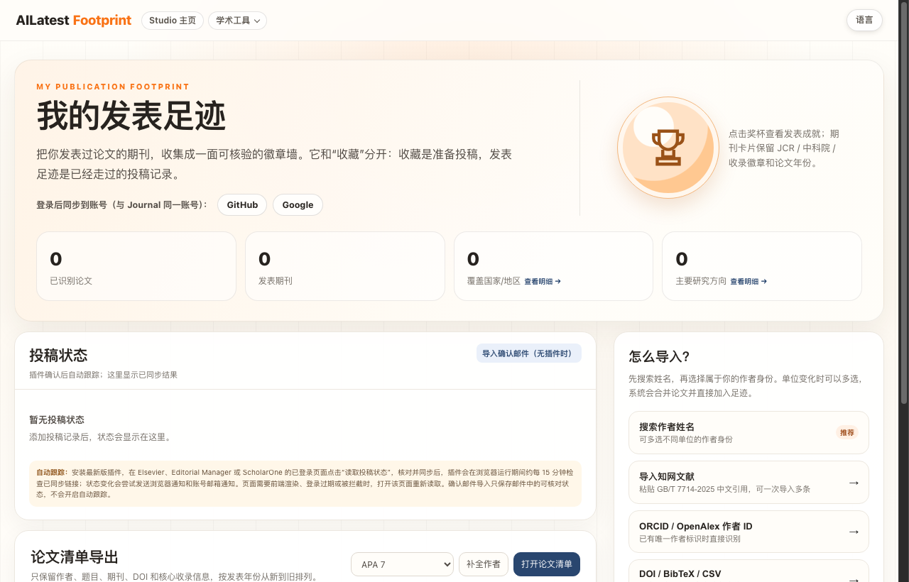

  <b>English</b> | <a href="#chinese"><b>中文说明</b></a>

# AILatest Footprint · Publication Badge Wall & Submission Tracker 🏅

  <b>Transform your published papers into a verified journal badge wall and automatically track active manuscript submissions.</b> 
  我的发表足迹。把发表过论文的期刊收集成一面可核验的徽章墙，支持作者姓名/ORCID/知网/BibTeX一键导入与投稿状态自动跟踪。

  
  
  
  

---

## 🖼 Visual Showcase

### 1. Official Cover Art

  

### 2. Live Application Interface

  

<em>Live screenshot captured from production: <a href="https://footprint.ailatest.org/">footprint.ailatest.org</a>.</em>

---

## 🌟 Key Features

1. **Academic Publication Badge Wall**: Group your published articles by target journal. Each card displays verified JCR Impact Factors, CAS Chinese Academy of Sciences quartiles, and publication years like prestigious badges.
2. **Multi-Source Bibliography Ingestion**:
   - **Author Name Search**: Resolves affiliations and merges papers across career transitions automatically.
   - **CNKI Citations (知网文献导入)**: Batch paste GB/T 7714-2025 citations to import Chinese publications instantly.
   - **ORCID & OpenAlex ID**: Instant one-click import from official author identifiers.
   - **File Uploads**: Direct import via DOI list, BibTeX (.bib), or CSV.
3. **Active Manuscript Submission Tracking**:
   - Install the companion browser extension to capture live submission statuses on logged-in journal portals (Elsevier, Editorial Manager, ScholarOne).
   - Monitors status every 15 minutes during browser operation and alerts you via browser notifications and email when status changes occur (e.g. *Under Review*, *Reviews Completed*, *Decision in Process*).
   - Supports manual confirmation email imports without browser extensions.
4. **Standardized Citation List Exporter**: One-click generation of verified bibliography lists formatted in **APA 7**, **MLA**, **Chicago**, or **GB/T 7714-2015**, complete with missing author reconciliation.
5. **Single Sign-On Sync**: Uses your unified AILatest account (shared with Journal, RefCheck, and Grant) via GitHub or Google login.

---

  <a href="#top"><b>Back to Top (English)</b></a> | <b>中文说明</b>

## 🇨🇳 中文介绍 · 我的发表足迹 (Footprint)

### 为什么需要发表足迹？
学者在申报职称、汇报成果或更新学术主页时，整理历年发表清单极其耗时，且学术期刊的分区与影响因子常因年份变化而难以核验。

**发表足迹（Footprint）把繁琐的发表记录变成一面可核验的学术荣誉徽章墙**：
1. **期刊徽章墙与学术成就**：按期刊聚合论文，卡片清晰保留发表年份以及官方核验的 JCR 影响因子、中科院升级版分区与收录徽章。
2. **四种灵活导入途径**：
   - **按作者姓名检索**：支持多选不同历史单位，自动去重合并学术成果；
   - **知网文献导入**：直接粘贴知网（GB/T 7714）引文，一秒批量导入中文核心期刊成果；
   - **ORCID / OpenAlex ID**：通过全球学术唯一识别码一键同步；
   - **DOI / BibTeX / CSV 文件导入**。
3. **在审论文投稿状态自动跟踪**：
   - 配合浏览器插件，在 Elsevier、Editorial Manager 或 ScholarOne 投稿页面一键同步；
   - 后台自动轮询并在状态变化时（如从 *Under Review* 变为 *Decision in Process*）发送邮件与浏览器通知；亦支持手动粘贴官方确认邮件。
4. **标准论文清单快速导出**：一键生成纯净的 APA 7、MLA、Chicago 或 GB/T 7714 格式参考文献，支持作者信息补全。

🌐 **立即在线体验**：[**https://footprint.ailatest.org/**](https://footprint.ailatest.org/)
